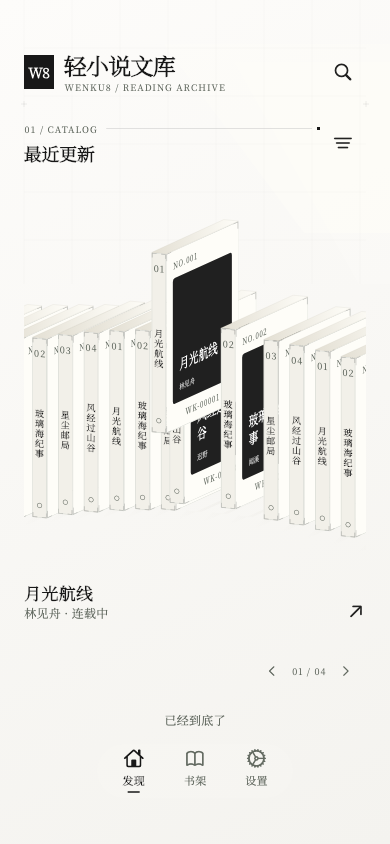
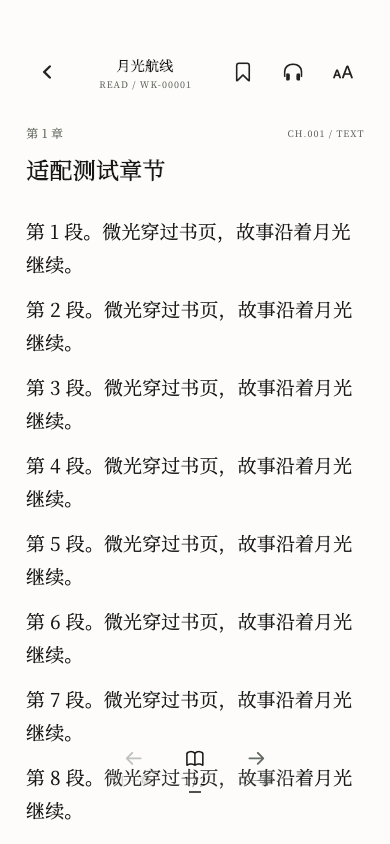
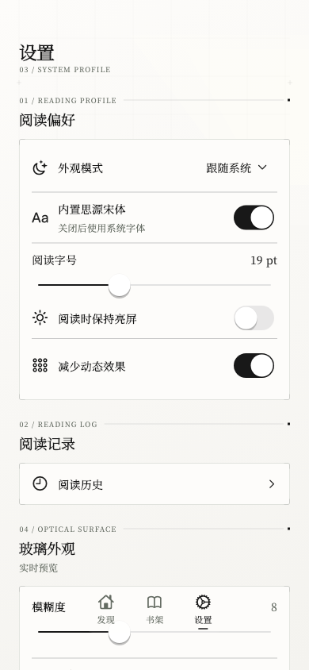

<p align="center">
  
</p>

<h1 align="center">轻小说文库</h1>

<p align="center">基于 Flutter 的 Android 轻小说阅读客户端，接入 Legado 书源</p>

<p align="center">
  
  <a href="assets/licenses/GPL-3.0.txt"></a>
</p>

<p align="center">
  <a href="CHANGELOG.md">更新日志</a> ·
  <a href="docs/READER.md">阅读器指南</a> ·
  <a href="docs/RELEASING.md">构建发布指南</a>
</p>

## 简介

轻小说文库是面向 Android 手机与平板的轻小说阅读客户端，基于「轻小说文库」（[Wenku8_Flutter](https://github.com/mikufoxxx/Wenku8_Flutter) 0.5.6）二次开发：在保留文库 8 阅读体验的基础上，接入了 Legado 书源解析，可以导入书源、跨书源搜索、换源、登录需要登录的书源，阅读小说与漫画。

> [!IMPORTANT]
> **本版本属于非官方修改版本。** 安装包由本地独立构建，不接入官方更新渠道。本版本基于「轻小说文库」二次开发，旨在提供更丰富的小说与漫画阅读体验。在此感谢原作者及其团队的辛勤付出与开源贡献。如果您认可并喜爱「轻小说文库」，欢迎通过原项目官方渠道赞助支持原作者，共同助力项目的持续发展。

## 界面预览

<p align="center">
  
  &nbsp;
  
  &nbsp;
  
</p>

## 功能特性

- **书籍发现**：发现页只接文库 8：分类、排行、出版文库；按书名、作者或标签筛选搜索。
- **书源搜索**：导入 Legado 书源后，在发现页搜索框跨书源找书；搜索结果分「轻小说文库」「书源」两区展示；只适配小说与漫画书源。
- **换源**：书源的书读不了或太慢时，可以换一个源继续读。
- **书源登录与验证**：需要登录或验证的书源可以正常登录或验证（含 WebView / Cloudflare 弹窗）。
- **书架管理**：文库 8 的书与书源的书放在同一个书架；立体书架展示全部书籍与分组。
- **阅读器**：文字章节用原版阅读器，支持滚动、横排翻页、竖排翻页；图片章节（漫画）用漫画阅读器。
- **离线阅读**：书源书籍支持离线下载，没网也能读。
- **账号与同步**：文库账号登录；云书架只同步文库 8 的书，书源的书只存本地。
- **听书**：章节听书，支持后台与锁屏控制。
- **更新记录**：应用内更新说明只保留最近 3 个版本。

不在本版本里的功能：本地导入（已去掉）；原版更新检查（已停用，本版本用自己的更新方式）。

## 下载与更新

当前版本 **1.0.17**，详见[更新日志](CHANGELOG.md)。本仓库不提供公开下载链接；安装包通过 GitHub Actions 云构建（见下）或自行构建。

## 构建

开发环境：**Flutter 3.41.5 / Dart 3.11.3、JDK 17、Android SDK**。

```sh
git clone https://github.com/Nathan-Zhong/qinxiaoshuo-wenku.git
cd qinxiaoshuo-wenku
flutter pub get
flutter build apk --release --target-platform android-arm64
```

说明：

- 包名 `com.cassidy.xiaoshuowenku`，与已安装的正式版一致，可覆盖升级。
- 签名密钥不在仓库里（`key.properties`、`.jks` 已忽略）。云构建从仓库 secrets 还原正式签名，正式包可直接覆盖安装；本地构建没有正式签名，装到已装正式版的手机上前需要先卸载旧版（会丢失本地书架与阅读记录）。
- 书源解析依赖原生 Kotlin 引擎与 `android/app/libs/` 下的 AAR，只支持 Android（arm64）；iOS 无法使用书源功能。
- 云构建：Actions 里的「Xiaoshuo Wenku Cloud Build」（`.github/workflows/xiaoshuo-build.yml`，手动触发）打 debug 包与正式包；「shell-build」（`.github/workflows/shell-build.yml`）用于在分支上打正式包。签名配置与发布流程见[构建发布指南](docs/RELEASING.md)。

## 贡献

欢迎通过 [Issues](https://github.com/Nathan-Zhong/qinxiaoshuo-wenku/issues) 反馈问题或提出建议，通过 Pull Request 参与开发。提交问题时请提供应用版本、Android 版本和复现步骤。详见 [CONTRIBUTING.md](CONTRIBUTING.md)。

## 致谢与许可

- 基于 [mikufoxxx/Wenku8_Flutter](https://github.com/mikufoxxx/Wenku8_Flutter)（0.5.6）二次开发；上游基于 [MewX/light-novel-library_Wenku8_Android](https://github.com/MewX/light-novel-library_Wenku8_Android) 重构。
- 书源解析复用 Legado 的规则引擎（原生 Kotlin 实现，通过 `lib/legado/` 桥接）。
- 应用源码：保留原项目 GPL v2 或后续版本声明（见 [LICENSE](LICENSE)），本 Flutter 组合版本按 [GPL v3](assets/licenses/GPL-3.0.txt) 分发。
- 内置字体与第三方组件见 [NOTICE](NOTICE) 与 [docs/THIRD_PARTY.md](docs/THIRD_PARTY.md)。
